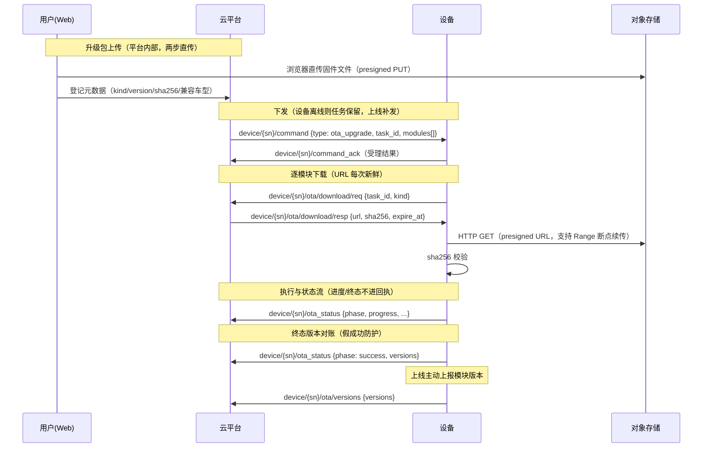

# OTA 升级相关

设备 OTA 升级（核心固件、算法模型等升级模块）的平台 ↔ 设备协议。

- **升级模块（kind）**：升级对象枚举，当前含 `core`（核心固件）、`algo_model`（算法模型），
  后续新增可升级模块时扩展取值，协议形状不变
- **升级任务**：一次下发 = 模块清单 × 设备集合。多模块任务设备按清单顺序执行，**只重启一次**
- **URL 换取模式**：下发清单不含 URL；设备受理后经 `ota/download/req` 按需换取新鲜
  presigned URL（大文件下载耗时长，预签 URL 会过期；断点续传重取也走此通道）

## 总体流程



## 升级下发（ota_upgrade）

经统一命令通道下发（命令与回执规范见 [mqtt_convention.md](./mqtt_convention.md)）。

- **协议类型**: MQTT
- **接口地址**: `device/:serial_number/command`（data.type = `ota_upgrade`）
- **接口方向**: 平台 -> 设备
- **QoS**: 1
- **请求参数**

  ```json
  {
    "msg_id": "uuid-789",
    "timestamp": 1757403776,
    "serial_number": "sn-191",
    "data": {
      "type": "ota_upgrade",
      "task_id": "0199b8d0-...", // 任务设备实例ID，后续 download/req、ota_status 原样回带
      "modules": [
        // 模块清单，顺序即设备端执行顺序；同一任务内 kind 不重复
        {
          "kind": "core", // 升级模块
          "version": "1.2.0", // 目标版本
          "sha256": "e3b0c442...", // 内容 sha256（hex），设备下载后校验
          "size": 10485760 // 字节数
        },
        {
          "kind": "algo_model",
          "version": "0.3.1",
          "sha256": "ba7816bf...",
          "size": 52428800
        }
      ]
    }
  }
  ```

- **回执**: `device/:serial_number/command_ack`（`msg_id` 回显）
  - 回执仅表达**受理**结果；下载/安装/重启进度与终态走 `ota_status` 状态流
  - `accepted` / `in_progress`：已受理，开始下载
  - `denied`：前置检查不满足（电量/模式/任务执行中等），`message` 带原因
  - `unsupported`：设备不支持 OTA
  - `temp_rejected` / 超时：平台保持已下发状态，由超时巡检兜底或人工重试

## 取消升级（ota_cancel）

- **协议类型**: MQTT
- **接口地址**: `device/:serial_number/command`（data.type = `ota_cancel`）
- **接口方向**: 平台 -> 设备
- **QoS**: 1
- **请求参数**

  ```json
  {
    "msg_id": "uuid-790",
    "timestamp": 1757403776,
    "serial_number": "sn-191",
    "data": {
      "type": "ota_cancel",
      "task_id": "0199b8d0-..."
    }
  }
  ```

- **接口说明**
  - 仅下载完成前设备可实际中断；已过不可中断点（开始安装）则设备继续完成并上报终态，
    平台以设备终态为准
  - 平台侧实例已先置「已取消」，取消命令尽力下发，无需 command_ack 之外的应答

## 下载请求

- **协议类型**: MQTT
- **接口地址**: `device/:serial_number/ota/download/req`
- **接口方向**: 设备 -> 平台
- **QoS**: 1
- **请求参数**

  ```json
  {
    "msg_id": "uuid-100",
    "timestamp": 1757403776,
    "serial_number": "sn-191",
    "data": {
      "task_id": "0199b8d0-...",
      "kind": "core" // 请求下载的升级模块（多模块任务逐模块请求）
    }
  }
  ```

## 下载响应

- **协议类型**: MQTT
- **接口地址**: `device/:serial_number/ota/download/resp`
- **接口方向**: 平台 -> 设备
- **QoS**: 1
- **响应参数**

  ```json
  {
    "msg_id": "uuid-100", // 复用请求的 msg_id
    "timestamp": 1757403776,
    "serial_number": "sn-191",
    "data": {
      "task_id": "0199b8d0-...",
      "kind": "core",
      "version": "1.2.0", // 实际准备的版本
      "filename": "core-1.2.0.bin",
      "url": "http://minio/...?X-Amz-Signature=...",
      "size": 10485760,
      "sha256": "e3b0c442...", // 下载完成后校验
      "expire_at": 1757407376 // URL 过期时间，Unix 时间戳（秒）
    }
  }
  ```

- **接口说明**
  - 设备须在 `expire_at` 前通过 HTTP GET 下载；支持 `Range` 断点续传
  - URL 过期后重新发起 `ota/download/req` 换取新鲜 URL，无需重新受理

## 状态流上报

下载/安装/重启全程经状态流上报（同 `mission_current` 模式，不进 command_ack）。

- **协议类型**: MQTT
- **接口地址**: `device/:serial_number/ota_status`
- **接口方向**: 设备 -> 平台
- **QoS**: 1
- **请求参数**

  ```json
  {
    "msg_id": "uuid-200",
    "timestamp": 1757403776,
    "serial_number": "sn-191",
    "data": {
      "task_id": "0199b8d0-...",
      "phase": "downloading", // downloading|downloaded|installing|rebooting|success|failed
      "progress": 0.6, // [0,1]，仅 downloading/installing 相位有意义
      "fail_kind": null, // failed 时：失败的升级模块
      "message": "", // 可选，补充说明（失败原因等）
      "versions": null // 终态 success 必填：{"core":"1.2.0","algo_model":"0.3.1"}
    }
  }
  ```

- **接口说明**
  - `phase` 单向推进，`downloaded` 为瞬态（平台直接归入 installing）
  - 终态 `success` **必须携带 `versions`**（安装后各模块实际版本）：平台与任务目标
    版本全量对账，不一致置「版本不符」（假成功防护），不认可为成功
  - 终态 `failed` 建议携带 `fail_kind` + `message` 定位失败模块与原因
  - 实例到达终态后，后续同 task_id 上报平台幂等丢弃；唯一例外：平台已取消的实例
    若设备继续完成并上报真实终态，以设备终态覆盖
  - 进度长时间停滞由平台超时巡检置「超时」（下载 30min / 安装+重启 15min / 已下发未动 5min），
    设备端无需自报超时

## 模块版本上报

设备**上线后**上报当前各模块版本（平台登记「当前版本」，供升级前快照与页面展示）。

- **协议类型**: MQTT
- **接口地址**: `device/:serial_number/ota/versions`
- **接口方向**: 设备 -> 平台
- **QoS**: 1
- **请求参数**

  ```json
  {
    "msg_id": "uuid-300",
    "timestamp": 1757403776,
    "serial_number": "sn-191",
    "data": {
      "versions": {
        "core": "1.1.9",
        "algo_model": "0.3.0"
      }
    }
  }
  ```

- **接口说明**
  - 版本表只含设备实际具备的模块；新增升级模块时设备按自身能力上报
  - OTA 终态对账通过的版本平台已自动登记，无需重复上报

## 设备行为约定

### 前置检查

受理升级命令前设备自检（不满足回 `denied` 并在 `message` 说明）：
电量/供电充足、非任务执行中、存储空间足够、目标版本未在安装中等。

### 执行顺序与重启

多模块任务按 `modules` 顺序逐个下载校验，全部就绪后依次安装，
**仅在最末模块安装完成后重启一次**。

### 失败处理

任一模块下载校验失败或安装失败：上报 `phase=failed`（带 `fail_kind`），
任务终止，不继续后续模块；等待平台重新下发。
